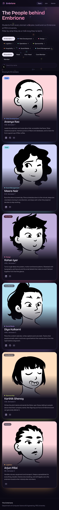
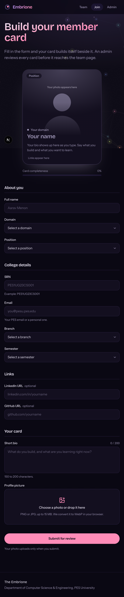
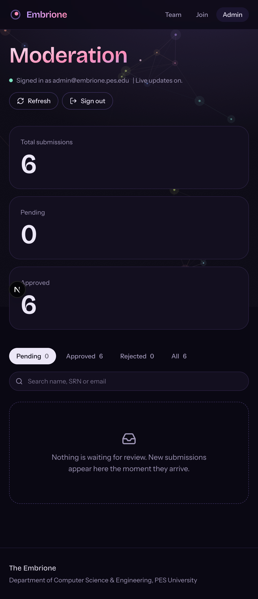
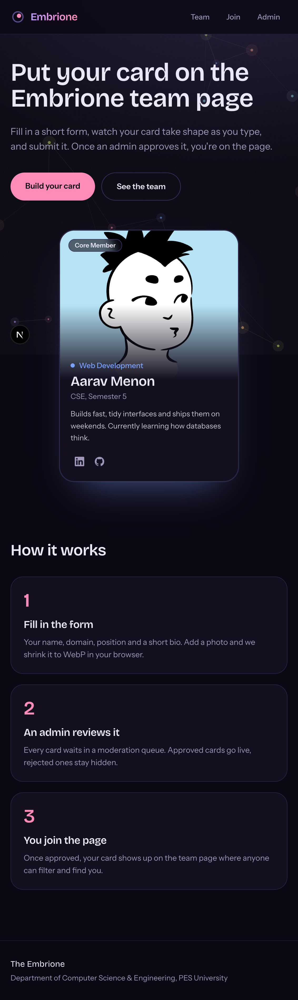

# Embrione: Meet the Team

A full-stack onboarding and moderation system for The Embrione (PES University, CSE).
Members build a card with a live preview, an admin approves it, and approved members appear on a public, filterable team page.

**Live site:** `https://keerthan-embrione-task.vercel.app`

**Stack:** Next.js (App Router) · TypeScript · Tailwind CSS v4 · Supabase (Postgres, Auth, Storage, Realtime) · Vercel

## Screenshots

| Team directory | Register with live preview |
|---|---|
|  |  |

| Admin moderation | Home |
|---|---|
|  |  |

## Pages

| Route | What it does |
|---|---|
| `/register` | Form on one side, live member card on the other. Photo is converted to WebP in the browser, uploaded only on submit, saved as `status: 'pending'`. |
| `/admin` | Sign-in protected. Counters, status tabs, search, approve / reject / delete with undo, keyboard shortcuts, live updates. |
| `/team` | Public directory showing approved members only. Filter by domain, position, or name. |

## Run it locally

1. **Create a Supabase project** at supabase.com.
2. **SQL Editor:** run `supabase/schema.sql`, then `supabase/seed.sql`.
   This creates the `members` table, row-level security, the `member-photos` public bucket, and 6 mock approved profiles.
3. **Create the admin user:** Supabase dashboard > Authentication > Users > Add user > Create new user.
   Email `admin@embrione.pes.edu`, password `EmbrioneAdmin@2026`, tick **Auto Confirm User**.
4. **Environment variables:** copy `.env.example` to `.env.local` and fill in the project URL and anon key (Project Settings > API).
5. Install and start:

```bash
npm install
npm run dev
```

Open http://localhost:3000.

## Deploy on Vercel

1. Push this repo to GitHub (public).
2. Import it in Vercel.
3. Add `NEXT_PUBLIC_SUPABASE_URL` and `NEXT_PUBLIC_SUPABASE_ANON_KEY` under Project Settings > Environment Variables.
4. Deploy, then set the domain to `<firstname>-embrione-task.vercel.app` under Settings > Domains.

## How it works

- **Live preview:** all form values live in one React state object. `MemberCard` receives that object, so every keystroke re-renders the card.
- **WebP conversion:** `src/lib/image.ts` decodes the photo with `createImageBitmap` (respecting phone rotation), draws it onto a canvas capped at 800 px, and re-encodes with `canvas.toBlob(..., "image/webp", 0.8)`. A 9 MB JPEG becomes roughly 80 KB. The form shows the before and after sizes.
- **Upload on submit only:** the preview uses the converted blob locally. Nothing reaches Supabase until the user presses Submit.
- **Duplicate SRN check:** a small SQL function `srn_status()` answers whether an SRN exists without exposing private rows. A unique index on `upper(srn)` is the final guard.
- **Security:** row-level security lets visitors insert only `pending` rows and read only `approved` rows. Update, delete and full reads need the admin's signed-in session. The storage bucket accepts WebP files only.
- **Admin auth:** Supabase Auth (`signInWithPassword`) with the admin account from the brief. Policies check the signed-in email.
- **Realtime:** the admin dashboard subscribes to changes on `members`, so new submissions appear without refreshing.

## Project structure

```
src/
  app/            routes: /, /register, /admin, /team
  components/     MemberCard, Field, Nav, register/, admin/, team/
  lib/            supabase client, WebP converter, validation, DB functions
supabase/         schema.sql and seed.sql
```

## Accessibility and responsiveness

Labelled form controls with error messages tied to fields, visible focus rings, reduced-motion support, and layouts checked down to 390 px wide. On phones a floating "Preview card" button jumps back to the live card.

## What I learned

This was my first project using Supabase and client-side image processing, and I built it phase by phase. Things that were new to me:

- **Row-level security.** The anon key is public in the browser, so the database policies are the real protection. Visitors can only insert `pending` rows and read `approved` ones, and only the signed-in admin can approve, reject or delete.
- **Client-side WebP conversion.** I decode the photo, shrink it on a canvas to at most 800 px, and re-encode it with `canvas.toBlob`. A large JPEG drops to under 100 KB, and the form shows the before and after sizes. I also learned that phone photos need their EXIF rotation applied, or they come out sideways.
- **Uploading on submit, not on select.** The preview uses a local blob URL, so nothing reaches storage until the user submits, and abandoned forms leave no stray files.
- **Duplicate SRN handling in two layers.** A small SQL function tells the form whether an SRN is taken without exposing private rows, and a unique index is the final guard against two people submitting at once.
- **Deploying with environment variables.** My first production build failed until I fixed the Supabase URL (it had `/rest/v1/` on the end) and added the variables in Vercel, which taught me to deploy early.

If I had more time, I would add image cropping, pagination on the team page, and automated tests for the form rules.
